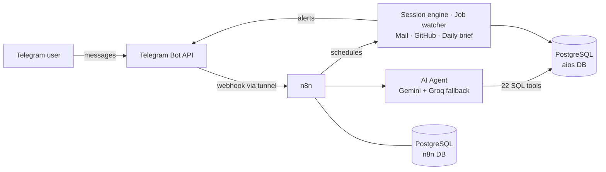

# AI Automation OS

A self-hosted personal assistant that runs my day from **Telegram**: tasks and study sessions, freelance job
scouting with proposal drafts, important-email alerts, and GitHub activity updates.
Built with **n8n + PostgreSQL + Docker**, with free-tier LLMs used only where real understanding is needed.

> Built to solve a real problem: too many university tasks, a bootcamp on top, and no time to scout freelance work.
> The assistant finds matching jobs and drafts the proposal from my real CV. **I review and submit every proposal myself.**

## What it does

| Area | Behaviour |
|---|---|
| **Tasks & schedule** | Create / list / complete tasks and schedule entries in plain Arabic or English from Telegram |
| **Study sessions** | A weekly timetable generates sessions. The bot announces each session, sends the next one when it ends, and accepts corrections ("didn't study X") |
| **Daily brief** | Morning plan, evening review, and one alert per task due within 24 h |
| **Freelance scout** | Reads public listing pages every 15 min (read-only, no login), keyword-filters tech jobs, alerts on Telegram |
| **Job analysis & proposals** | Paste a job → match score from *my CV only* → proposal draft + technical plan. Never submits anything |
| **Mail watcher** | Forwards only important emails (platform notifications, university, interview/payment keywords) |
| **GitHub watcher** | Reports pushes, new repos and pull requests (public events, no token needed) |

## Architecture



## Design decisions

- **LLM only where it matters.** Free tiers have hard daily/minute limits, so session messages, daily briefs, deadline
  alerts and job filtering are plain SQL/JavaScript. The model handles intent, analysis and proposal writing.
- **No fabricated skills.** Skills are stored with a `source` constraint (`cv` / `user_confirmed`); the agent may only
  claim what exists there.
- **Human in the loop.** The assistant never applies to jobs or contacts clients.
- **Two databases, two roles.** n8n cannot read app data and vice versa. Postgres publishes no port; the n8n editor binds to localhost.
- **Idempotent notifications.** `notifications.dedupe_key` stops repeated alerts; job dedupe uses `(platform, external_id)`.
- **Prompt-injection aware.** Job posts and tool output are treated as data, never as instructions.

## Repository layout

```
n8n/workflows/   01-main-assistant · 02-session-engine · 03-automations · 04-mail-watcher
n8n/tools/       site-check (one-time diagnostic for job sites)
postgres/        init + migrations (001-002 core schema, 003 job codes, 004-005 sessions & timetable)
examples/        seed_profile.example.sql · timetable.example.sql  (copy, edit, run)
docs/            system-prompt.txt · TEAM_MODE.md
*.ps1            start-aios · backup-aios · migrate · refresh-tunnel   (Windows PowerShell)
docker-compose.yml / docker-compose.ngrok.yml
```

## Quick start (Windows + Docker Desktop)

1. `copy .env.example .env`, then fill every `CHANGE_ME` with random hex (PowerShell:
   `-join ((1..48) | % { '{0:x}' -f (Get-Random -Max 16) })`). Set `OWNER_TELEGRAM_ID`.
2. `docker compose up -d`, then `powershell -ExecutionPolicy Bypass -File .\migrate.ps1`.
3. Create the owner row (`scripts/seed_owner.sh` logic, or insert into `users` with role `owner`).
4. Load your profile and timetable from `examples/` (edit first), then run them with `psql`.
5. In n8n create credentials: **Telegram**, **Postgres** (host `postgres`, DB `aios`, user `aios_app`), **Gemini**, **Groq**, and
   optionally **IMAP** (Gmail app password).
6. Import the workflows **each into its own new, empty workflow**, select credentials, edit the system prompt
   (`docs/system-prompt.txt`) and your GitHub username, then publish.
7. Telegram needs a public HTTPS URL: use `docker-compose.ngrok.yml` (permanent) or the Cloudflare quick tunnel
   (`refresh-tunnel.ps1` after every restart).
8. After every reboot: `.\start-aios.ps1`.

## Limits and honest notes

- Free LLM quotas are small; replies can take a while when a limit is hit (the Groq fallback helps).
- WhatsApp is not integrated (no safe official way to read a personal account): forward important messages to the bot.
- Upwork and similar sites block bots, so they are not scraped; use their own email alerts with the mail watcher.
- Job scanning is read-only on public pages and may break when a site changes its HTML. Check each site's terms.
- Runs on a PC: if the machine sleeps, alerts pause (sessions are caught up when it wakes).

## Security checklist before publishing a fork

Never commit `.env`, `backups/`, or any file containing tokens, your CV, emails or personal IDs.
Bot tokens, API keys and passwords belong in n8n Credentials only. If a token ever appears in a chat or a commit, revoke it.

## Roadmap

Team mode for 5 members (per-member job routing, claim command, win → project → tasks): see [docs/TEAM_MODE.md](docs/TEAM_MODE.md).

---
**بالعربي باختصار:** أسيستنت شخصي على Telegram بيدير التاسكات وجلسات المذاكرة، وبيراقب مواقع الفريلانس ويبعتلي الشغلانة
المناسبة ويجهّز مسودة بروبوزال من الـ CV، وبيبلّغني بالإيميلات المهمة ونشاط GitHub. كله على n8n وPostgreSQL وDocker.
